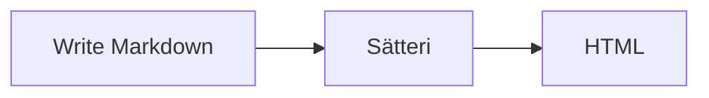

import { Image } from "astro:assets";
import screenshot from "../../assets/projects/sta/1.jpg";

This post is a draft, so it only shows up on the dev server. It exists to check every feature
against the site's styles. Text can be **bold**, _italic_, ~~struck~~, `inline code`,
H~2~O or x^2^, and [linked](https://nath.tw). Quotes and dashes -- like these -- turn "smart".

## Code

```ts title="src/lib/posts.ts" {2}
export const getPosts = async () => (await getCollection("blog")).sort(byDate);
```

Shiki's notation comments also work:

```js
const greeting = "hello"; // [!code --]
const greeting = "hi"; // [!code ++]
console.log(greeting); // [!code highlight]
```

## Lists and tables

- [x] Content collection
- [x] Math and diagrams
- [ ] Write the first real post

| Feature   | Syntax     |
| :-------- | :--------- |
| Callouts  | `:::note`  |
| Footnotes | `[^1]`[^1] |

Definition list
: A term followed by its meaning.

## Callouts

<Callout kind="tip" title="From MDX">
  The `<Callout>` component is available in every MDX post without an import.
</Callout>

## Math

Inline math like $e^{i\pi} + 1 = 0$ sits in the text, and display math gets its own line:

$$
\int_0^1 x^2 \, dx = \frac{1}{3}
$$

## Diagrams



## Images

Local images are optimised, in Markdown or with `<Image />`:

<Image src={screenshot} alt="A screenshot of the STA site" />

> A blockquote, for good measure.

[^1]: Footnotes collect at the end of the post.
